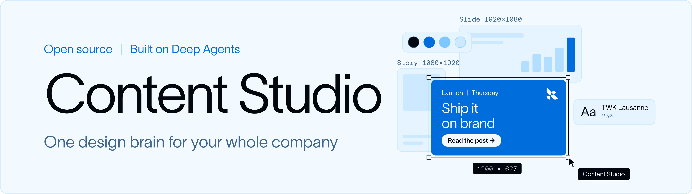
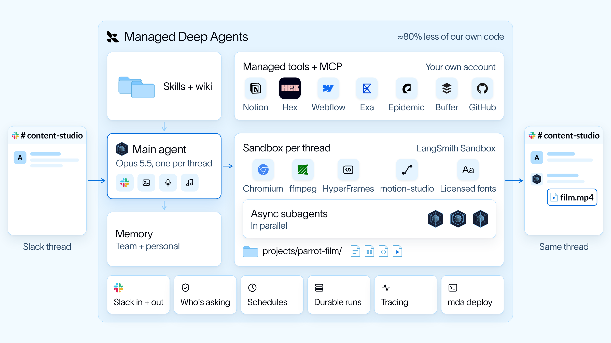
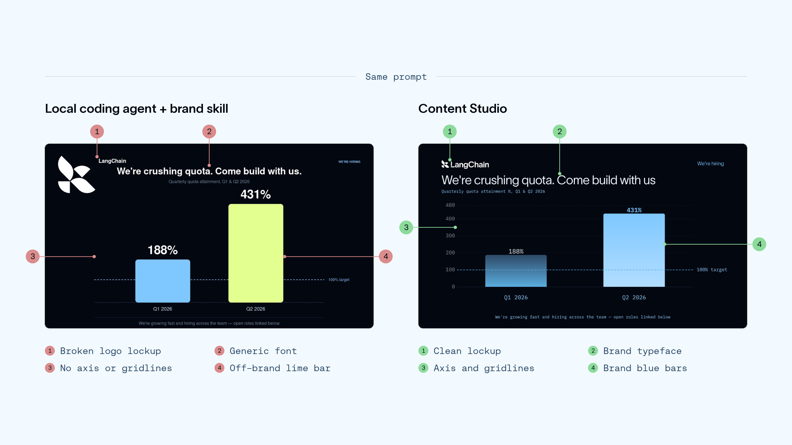
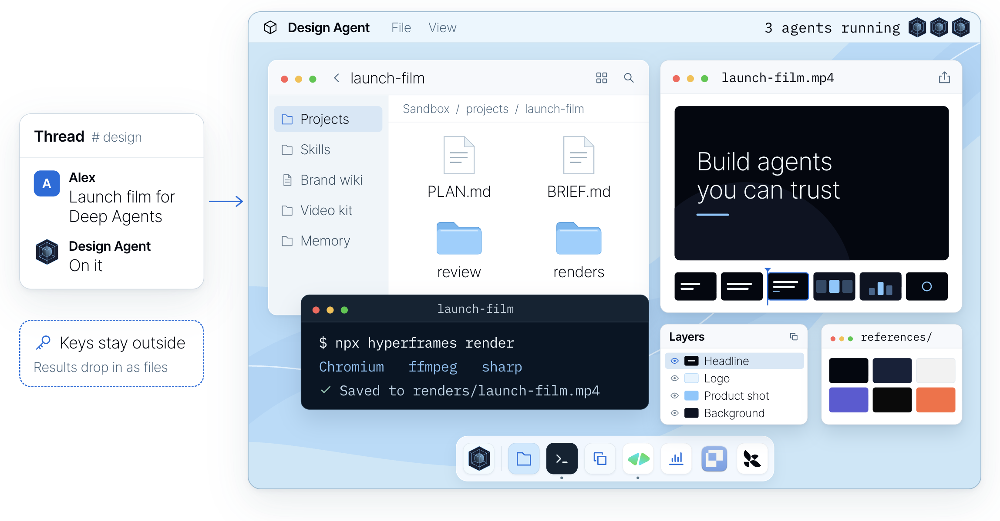

<div align="center">
  <p>
    <a href="https://www.langchain.com/?utm_source=github&utm_medium=readme&utm_campaign=design-agent#gh-light-mode-only"></a><a href="https://www.langchain.com/?utm_source=github&utm_medium=readme&utm_campaign=design-agent#gh-dark-mode-only"></a>
  </p>
  <picture>
    <source media="(prefers-color-scheme: dark)" srcset="https://github.com/langchain-ai/design-agent/raw/main/docs/assets/readme/header-dark.png">
    
  </picture>
  <p>
    <a href="LICENSE#gh-light-mode-only"></a><a href="LICENSE#gh-dark-mode-only"></a>
    <a href="https://www.python.org#gh-light-mode-only"></a><a href="https://www.python.org#gh-dark-mode-only"></a>
    <a href="https://github.com/langchain-ai/deepagents#gh-light-mode-only"></a><a href="https://github.com/langchain-ai/deepagents#gh-dark-mode-only"></a>
    <a href="https://docs.langchain.com/langsmith/python/managed-deep-agents-overview?utm_source=github&utm_medium=readme&utm_campaign=design-agent#gh-light-mode-only"></a><a href="https://docs.langchain.com/langsmith/python/managed-deep-agents-overview?utm_source=github&utm_medium=readme&utm_campaign=design-agent#gh-dark-mode-only"></a>
  </p>
  <p>
    <b><a href="#quickstart">Content Studio をチームに導入する →</a></b> ·
    <a href="#try-it-locally">ローカルで試す（キー不要）</a> ·
    <a href="https://www.langchain.com/blog/design-agent?utm_source=github&utm_medium=readme&utm_campaign=design-agent">構築の裏側</a> ·
    <a href="docs/README.md">ドキュメント</a>
  </p>
  <p>
    <a href="README.md">English</a> · <a href="README.zh-CN.md">简体中文</a> · <b>日本語</b>
    <br><sub>この翻訳は英語版 README を基準としており、更新が遅れる場合があります。</sub>
  </p>
</div>

**Content Studio は LangChain が社内で使っているデザインエージェントで、オープンソースになりました。**
ブランドを追加し、Managed Deep Agents でチームの Slack にデプロイしましょう。誰でもデザイナーに頼むように依頼し、
手元の素材を添付するだけで、リサイズした広告からローンチ映像まで、ブランドに沿った完成ファイルを受け取れます。

8 月以降、3,000 点以上のアセットを制作し、その作品を使った投稿は X で約 450 万回表示されました。
依頼の 4 分の 3 はマーケティング以外のチームからです。各部分の詳細は[構築の裏側](https://www.langchain.com/blog/design-agent?utm_source=github&utm_medium=readme&utm_campaign=design-agent)で解説しています。

## 動いているところを見る

Content Studio に自分自身のローンチ映像を作らせたところ、完全に『ロッキー』になりました。

https://github.com/user-attachments/assets/ee5b98e0-7ec6-4b24-ada6-1f27087947a3

<p align="center"><sub>1 ビットのひよこからチャンピオンまで、47 秒で。</sub></p>

## 仕組み

Content Studio は [Deep Agents](https://github.com/langchain-ai/deepagents) のエージェントで、デプロイ先は
[Managed Deep Agents](https://docs.langchain.com/langsmith/python/managed-deep-agents-overview?utm_source=github&utm_medium=readme&utm_campaign=design-agent) です。
Managed Deep Agents がインフラ（Slack、サンドボックス、メモリ、スケジュール、トレーシング）を担い、
このリポジトリはその上で動くデザインエージェントです。クリエイティブな判断はモデルが行い、
レンダリング、チェック、納品はコードが行います。

<p align="center">
  <picture>
    <source media="(prefers-color-scheme: dark)" srcset="https://github.com/langchain-ai/design-agent/raw/main/docs/assets/readme/architecture-dark.png">
    
  </picture>
</p>

<p align="center"><sub>LangChain での運用構成です。あなたのコピーは、有効にしたインテグレーションから始まります（<a href="docs/integrations.md">インテグレーション</a>）。</sub></p>

- **Slack。** スレッドで要件とファイルを添えてメンションします。MDA の Slack アプリがメッセージと
  添付ファイルをエージェントに渡し、完成したファイルは同じスレッドに返ってきます。作業中は 1 つのメッセージが
  ステップごとに更新され、フッターには実行中の処理とここまでのコストが表示されます。途中で追加した内容も
  進行中の作業に反映されます。
- **スレッドごとに 1 台のコンピューター。** 各スレッドには専用の LangSmith サンドボックスが用意されます。
  Chrome、FFmpeg、[HyperFrames](https://hyperframes.heygen.com)、D2、そしてあなたのフォントを備えた Linux マシンで、
  バージョン固定された 1 つのレシピ（[`sandbox/setup.sh`](sandbox/)）から構築されます。作るものはすべて
  プロジェクトフォルダー内のコード（スライドは HTML、映像はアニメーションのタイムライン）なので、変更は編集して
  再レンダリングするだけで、最初からやり直す必要はありません。API キーがサンドボックスに入ることはありません。
- **スキルとデザイン wiki。** 常時読み込まれるプロンプトは小さく保たれています。依頼ごとに、まず
  ルータースキルを読み、35 の[スキル](skills/)からリサイズ広告からローンチ映像まで適切なワークフローを選びます。
  wiki にはデザインの知見（タイポグラフィ、色、レイアウト、チャート）が、ブランドパックにはブランドの事実が
  入っています。スキルは必要なときだけ読み込まれ、MDA が Context Hub から提供します。
- **あなたのツール。** 映像は HyperFrames で作られます。HyperFrames は映像をタイムライン上の Web ページとして
  扱います。[Paper](https://paper.design) は共有キャンバスで、絵コンテやレイアウトを直接編集できます。
  画像・音声・音楽のモデルはサンドボックスの外でツールとして動き、Notion、Linear、GitHub、Figma などの
  MCP サーバーは MDA 経由で接続され、各自が自分のアカウントでサインインします。
- **非同期サブエージェント。** 大きな作業では、メインエージェントが計画を立てて作業を分割し、同じ
  サンドボックスとファイル上でバックグラウンドのサブエージェントを起動します。サブエージェントが完了・失敗・
  停滞すると MDA がメインエージェントを起こすので、待ちぼうけになることなく会話を続けられます。映像は絵コンテ、
  アニマティック、本制作の順に進み、各パートは組み立て前にコードによるレビューを通過します。
- **メモリ。** ルールは一度伝えれば（「LinkedIn ではオレンジを使わない」）、そのターンで保存されます。
  MDA はファイルによる 2 層のメモリを提供します。全員で共有するチームメモリと、各自の個人メモリです。
  各層のインデックスは毎回の実行で読み込まれます。
- **使うほど良くなる。** 作業が終わると、`learn_from_job` が使ったスキルに対して何がうまくいったかを
  メモします。後の作業がそのメモを読んで評価し、役に立たなかったものは削除されます。

### 自分で解説させる

自分のハーネス（作業環境）を、ピクセルのオウムが主役の自然ドキュメンタリーとして解説させました。
コンピューター、ツール、そして作業の裏にあるコンテキストを順に案内します。

https://github.com/user-attachments/assets/65eac8e4-0fac-4a5a-9cca-02e26a0a8baa

<p align="center"><sub>絵コンテ、制作、ナレーションまで、エージェントが 1 つの Slack スレッドで行いました。</sub></p>

<details>
<summary>この映像を作ったプロンプト</summary>

エージェントは、この依頼と数回のフィードバックから作りました：

> Make a short explainer of how you create videos in code, end to end, for our blog post on the
> media harness we built on Deep Agents. Narrate it like a David Attenborough nature documentary,
> starring the pixel parrot from our promo, with your subagents as its flock. Keep it technical
> enough for an engineer, in real terms: skills, wiki, tools, apps. Storyboard it before you build,
> and end on "Built on Managed Deep Agents".

</details>

[アーキテクチャ](docs/architecture/README.md)を読むか、さっそく変更してみましょう：
[instructions.md](instructions.md) · [skills/](skills/) · [カスタマイズ](docs/customization.md) ·
[評価](docs/evals.md) · [運用](OPERATIONS.md) · [コントリビュート](CONTRIBUTING.md)。

## AI っぽく見えない理由

<p align="center">
  <picture>
    <source media="(prefers-color-scheme: dark)" srcset="https://github.com/langchain-ai/design-agent/raw/main/docs/assets/readme/same-prompt-dark.png">
    
  </picture>
</p>

<p align="center"><sub>同じプロンプトを、ブランドスキル付きのローカルのコーディングエージェントと Content Studio に渡した結果。</sub></p>

- **自分の作品を見る。** レンダリングしてから画像を確認し、それから投稿します。
- **ブランドはコード。** レイアウトに使えるのはあなたのトークン（色、フォント、余白）だけです。
- **機械で数えられるものはチェックする。** 色、フォント、コントラスト、サイズ、チャートの数値は、
  レンダリングのたびにコードでチェックされます。センスの判断はデザイナーに委ねます。

<p align="center">
  
</p>

<a name="quickstart"></a>

## クイックスタート

| 自前で構築する場合 | ここから始める場合 |
| --- | --- |
| ハーネス、サンドボックス、スキル、Slack の UX に数か月 | フォークしてブランドを追加し、コマンド 1 つでデプロイ |
| 洗練されているが、他の何百もの作品と同じに見える | あなたのブランドに沿い、レンダリングのたびにチェックされる |
| デザイン依頼がキューで順番待ち | 誰でも Slack で依頼でき、グラフィックは数分、長いスライドは一晩で |
| どのチームも同じミスを直している | スキルを一度直せば、以降のすべてのアセットに反映 |

このリポジトリは [Managed Deep Agents](https://docs.langchain.com/langsmith/python/managed-deep-agents-overview?utm_source=github&utm_medium=readme&utm_campaign=design-agent) プロジェクトなので、そのまま LangSmith ワークスペースに
デプロイできます。必要なのは LangSmith アカウント（Managed Deep Agents は LangSmith Cloud でパブリックベータ提供中）と
モデルのキーです：

```bash
curl -fsSL https://raw.githubusercontent.com/langchain-ai/design-agent/main/install.sh | bash
cd design-agent
uv run design-agent config set LANGSMITH_API_KEY=lsv2_… ANTHROPIC_API_KEY=sk-ant-…
uv run design-agent sandbox publish   # once per workspace, 10-15 min: the agent's computer
uv run mda deploy                     # the agent itself, and its Slack app
```

インストーラーは、[uv](https://docs.astral.sh/uv/) がなければ取得し、リポジトリをクローンして依存関係を
インストールします。`git clone` と `uv sync` でも同じことができます。

最後の 2 つのコマンドは役割が違います。`sandbox publish` は、各スレッドが作業する Linux マシンを
LangSmith ワークスペースのスナップショットとして構築します。この時点ではまだ話しかけられるものは存在しません。
`mda deploy` がエージェントをデプロイし、エージェントはスレッドごとにそのマシンを複製します。
再パブリッシュが必要なのは `sandbox/setup.sh` を変更したときだけです。

**LangSmith Gateway を使っていますか？** プロバイダーのキーは不要です。
`uv run design-agent config set DESIGN_AGENT_MODEL=langsmith:anthropic/claude-opus-5-5` を実行してください。
エージェントは `LANGSMITH_GATEWAY_API_KEY`（なければ `LANGSMITH_API_KEY`）を使い、`OPENAI_API_KEY` がない場合は
画像生成もゲートウェイ経由になります。その他の OpenAI 互換エンドポイントには、`DESIGN_AGENT_MODEL_BASE_URL` と
`DESIGN_AGENT_MODEL_API_KEY_ENV` を設定してください（[モデル](docs/models.md)）。

初回のデプロイでエージェントの Slack アプリがセットアップされます。ワークスペースで承認し、チャンネルで
エージェントをメンションしてください。LangChain でもこの形で運用しています。変更を試すときは
`uv run mda deploy --name design-agent-test` で別のコピーを使いましょう。エージェントモードが有効なワークスペースでは、
`uv run mda deploy --agent-environment production`（または `staging`、`development`）でエージェントのその環境に
デプロイでき、環境ごとにトレースが分かれます。LangSmith でエージェントを開き、環境を選んでください。
`uv run mda dev` のトレースは Local 環境に記録されます。キー、デプロイされる内容、動作確認については
[MDA でデプロイする](docs/deploy-mda.md)を参照してください。

**コーディングエージェントに任せることもできます。** Claude Code、Codex、Cursor でリポジトリを開き、
やりたいことを伝えてください。[AGENTS.md](AGENTS.md) が各依頼をステップバイステップの[スキル](.agents/skills/)に
振り分けます：

| 伝えること | エージェントがすること |
| --- | --- |
| 「Slack にデプロイして」 | サンドボックスをパブリッシュし、デプロイ内容を確認し、あなたの承認後にデプロイ |
| 「Web サイトとブランドガイドからブランドパックを作って」 | パックを下書きして検証し、レビューを依頼 |
| 「週刊ニュースレターのヘッダーを作れるようにして」 | そのためのスキルを追加し、実際の依頼で試す |
| 「その変更で良くなった？」 | 変更前後で評価を実行し、数値を見せる |

<a name="try-it-locally"></a>

## ローカルで試す

デモは、スクリプト化されたモデルを使い、API キーなしで本物のエージェント、サンドボックス、チェックを実行します。
**Docker** が必要で、`workspace/out/demo/` に 3 サイズのローンチカードと 4 秒のティーザーが出力されます：

```bash
uv run design-agent sandbox build
uv run design-agent demo
```

`.env` にモデルのキーを設定すれば、本当の依頼ができます。ファイルは `workspace/out/<thread>/` に保存され、
最後の行にその実行のコストが表示されます：

```bash
uv run design-agent ask "A LinkedIn card announcing our design review service, 1200x627."
```

## 自分のものにする

このリポジトリには 2 種類のスキルがあります。[`.agents/skills/`](.agents/skills/) のスキルは、セットアップ、
ブランド設定、デプロイ、リポジトリの変更のためにあなたのコーディングエージェントが使うものです。
[`skills/`](skills/) のスキルは、Content Studio が作業中に読むものです。両方について
[カスタマイズ](docs/customization.md)で説明しています。

| やりたいこと | 追加するもの | ガイド |
| --- | --- | --- |
| あなたのブランド | `workspace/brand/`（それまではニュートラルなサンプルブランド）を追加して再デプロイ | [brand-onboarding スキル](.agents/skills/brand-onboarding/SKILL.md) |
| 画像生成 | `OPENAI_API_KEY`、`GOOGLE_API_KEY`、または LangSmith Gateway | [モデル](docs/models.md) |
| 音声、音楽、効果音 | `ELEVENLABS_API_KEY` | [sound スキル](skills/sound/SKILL.md) |
| Paper キャンバス | Paper Desktop と `PAPER_MODE=local`、デプロイ時は `bridged` | [Paper](docs/partners/paper.md) |
| Web 検索、社内ドキュメント、その他のツール | `config/mcp.toml` の MCP サーバー | [カスタマイズ](docs/customization.md) |

自分のものになったら、デザイナーに頼むように Slack で依頼してみましょう：

- 「新機能のローンチカードを、LinkedIn、X、Instagram のサイズで」
- 「ローンチ用に『ロッキー』風のプロモ映像を、音楽と効果音付きで」
- 「この CSV から週ごとのサインアップ数のチャートを」（ファイルを添付）
- 「この動画の YouTube サムネイルを」
- 「このウェビナーのクリップに字幕を付けて」（クリップを添付）

このページはすべて LangChain のブランドを使っています。私たちが運用しているのがそれだからです。
ライセンス付きフォントは、Git の管理対象外である `private-fonts/` に置きます。

## よくある質問

**費用は？** コードは無料です（Apache 2.0）。費用はモデルプロバイダーへの支払いです。LangChain では 1 件あたりの
モデル費用の中央値は約 50 セントで、長い映像やスライドはそれ以上かかります。Managed Deep Agents の
[ホスティングは有料](https://www.langchain.com/pricing?utm_source=github&utm_medium=readme&utm_campaign=design-agent)です。エージェント、サンドボックス、
Slack アプリ、スケジュールを実行してくれるので、本来なら自分で構築・運用する必要があるものを任せられます。

**自社のブランドを使ってくれますか？** はい。ブランドパックを追加すれば、すべてのファイルがそれに従います。
[brand-onboarding スキル](.agents/skills/brand-onboarding/SKILL.md)が、ブランドガイド、Web サイト、ファイル、
Paper ファイルから一緒にパックを作ります。

**何から始めればいいですか？** チームが毎週依頼しているグラフィックからです。Slack でエージェントに依頼し、
作品をレビューして修正を頼めるようにしてから、次のことを教えていきましょう。

**Slack は必須ですか？** いいえ。デプロイの API を呼ぶ、LangSmith Studio で開く、ターミナル
（`design-agent ask`）を使う、といった方法もあります。Managed Deep Agents では、バックグラウンドで動く長い作業
（映像、複数案の並行制作）は Slack で報告されます。API 経由では、1 ターンで終わる依頼にとどめてください。

**キーは安全ですか？** サンドボックスは認証情報を一切持たず、デフォルトではネットワークにもアクセスできません。
取得、生成、納品はホスト側のツールが行い、結果をファイルとして渡します。

**どのモデルに対応していますか？** デフォルトは Claude Opus 5.5 です。OpenAI や Google のモデル、任意の
OpenAI 互換エンドポイント、LangSmith Gateway も使えます。[モデル](docs/models.md)を参照してください。

**自社サーバーで動かせますか？** はい。Apache 2.0 なので、[セルフホスティング](docs/self-hosting.md)で
Docker、HTTP API、独自の Slack アプリを使って同じエージェントを動かせます。

**なぜ名前が 2 つあるのですか？** Content Studio は LangChain でのこのエージェントの呼び名で、
`DESIGN_AGENT_SLACK_NAME` を設定しない限り Slack アプリの名前にもなります。リポジトリ、パッケージ、コマンドの
名前は `design-agent` です。

**デザイナーの代わりになりますか？** いいえ。繰り返しの依頼を引き受けることで、デザイナーは自分にしか
できない仕事に時間を使えます。そしてデザイナーの判断は、スキルとチェックの中に生き続けます。

**自分だけのものを作ろう。** フォークして、ブランドトークン、フォント、スキルを追加し、チームの Slack に
デプロイしましょう。[クイックスタート](#quickstart)。役に立ったら、スターを付けていただけると他のチームが
見つけやすくなります。

## 使用技術

<p>
  <a href="https://github.com/langchain-ai/deepagents"> <b>Deep Agents</b></a>
  &nbsp;&nbsp;
  <a href="https://docs.langchain.com/langsmith/python/managed-deep-agents-overview?utm_source=github&utm_medium=readme&utm_campaign=design-agent"> <b>Managed Deep Agents</b></a>
  &nbsp;&nbsp;
  <a href="https://hyperframes.heygen.com"> <b>HyperFrames</b></a>
  &nbsp;&nbsp;
  <a href="https://paper.design"> <b>Paper</b></a>
</p>

その他：[LangSmith](https://smith.langchain.com/?utm_source=github&utm_medium=readme&utm_campaign=design-agent) ·
[Chrome Headless Shell](https://developer.chrome.com/blog/chrome-headless-shell) ·
[FFmpeg](https://ffmpeg.org) · [D2](https://d2lang.com) · [Apache ECharts](https://echarts.apache.org) ·
[sharp](https://sharp.pixelplumbing.com)。ロゴは各所有者に帰属します。HyperFrames と Paper は、私たちが利用しているパートナープロジェクトです。

---

[Apache 2.0](LICENSE) · [通知](NOTICE.md) · [変更履歴](CHANGELOG.md) · [セキュリティ](SECURITY.md) · [行動規範](CODE_OF_CONDUCT.md)
