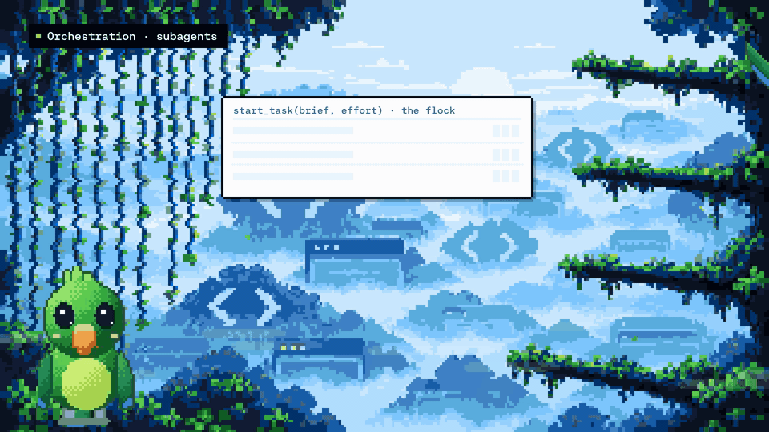

<div align="center">
  <p>
    <a href="https://www.langchain.com/">
      <picture>
        <source media="(prefers-color-scheme: dark)" srcset="docs/assets/readme/logos/langchain-company-dark.svg">
        
      </picture>
    </a>
  </p>
  <h1>Design Agent</h1>
  <p><strong>An open-source AI design agent</strong> that turns a chat thread into on-brand stills, decks,<br>diagrams, charts and motion graphics, built and checked on its own computer.</p>
  <p>
    <a href="https://github.com/langchain-ai/design-agent/actions/workflows/ci.yml"></a>
    <a href="LICENSE"></a>
    
    <a href="https://github.com/langchain-ai/deepagents"></a>
    <a href="https://docs.langchain.com/langsmith/python/managed-deep-agents-overview"></a>
    <a href="https://hyperframes.heygen.com"></a>
    <a href="https://paper.design"></a>
  </p>
  <p>
    <a href="#quick-start">Quick start</a> ·
    <a href="#architecture">Architecture</a> ·
    <a href="#deployment">Deployment</a> ·
    <a href="OPERATIONS.md">Documentation</a> ·
    <a href="CONTRIBUTING.md">Contributing</a>
  </p>
</div>

<picture>
  <source media="(prefers-color-scheme: dark)" srcset="docs/assets/readme/hero-dark.png">
  
</picture>

Ask in Slack or the terminal for an ad set, a LinkedIn card, a deck, a diagram, a chart, a thumbnail
set, a storyboard or a short film. Design Agent makes the concept, layout and copy calls, builds the
work as HTML, SVG and video on its own sandboxed computer, checks it against your brand with
deterministic gates, and delivers the files to the thread. It is a
[Deep Agents](https://github.com/langchain-ai/deepagents) application with one shared core and two
deployment paths: [Managed Deep Agents](https://docs.langchain.com/langsmith/python/managed-deep-agents-overview)
in one command, or self-hosted with Docker.

> [!NOTE]
> The images and film in this README use LangChain's brand, the brand we run it with. Design Agent
> ships with an original sample brand, and every output follows the brand pack you give it: build
> yours with the [brand-onboarding skill](.agents/skills/brand-onboarding/SKILL.md).

**Contents:** [What it makes](#what-it-makes) · [How it works](#how-it-works) ·
[Architecture](#architecture) · [Quick start](#quick-start) ·
[Your brand, media and Paper](#your-brand-media-and-paper) · [Deployment](#deployment) ·
[FAQ](#faq) · [Built with](#built-with)

## What it makes

- **Stills and sets:** layouts rendered in a real browser, each size recomposed rather than scaled;
  PDFs and decks; image edits; GIFs.
- **Diagrams and charts:** JSON specs rendered with ECharts and D2 on your brand, with the numbers
  and the topology checked in code.
- **Motion:** storyboards first, then [HyperFrames](https://hyperframes.heygen.com) compositions
  rendered to video, with voice, music and sound when keys are configured. Long films run as a
  pipeline of background helpers that check in with you at the right moments.
- **On brand:** a brand pack (tokens, colour roles, logos, fonts, voice, graphic language) is the
  agent's only source of brand facts, and gates check every output against it.
- **Paper:** layouts and storyboards go onto the [Paper](https://paper.design) canvas as editable
  layers when Paper is connected.

## How it works

<p align="center">
  <a href="docs/assets/readme/design-agent-explainer.mp4"></a>
  <br><sub><b><a href="docs/assets/readme/design-agent-explainer.mp4">Watch the 2-minute film</a></b>: a Slack request moving through the sandbox, skills, Paper, the helpers, HyperFrames, the checks and the sound.</sub>
</p>

Three layers are specific to design work. **The lead and its helpers** plan the job and hand out the
pieces. **The context** is skills, a design wiki, the brand pack and memory, loaded only when a job
needs them. **The designer's computer** is a sandbox with real tools, where everything is built and
checked. Underneath, the agent is off the shelf: the Deep Agents harness, Managed Deep Agents (or
your own infrastructure) and a frontier model. The model makes the creative calls. Code renders,
measures, runs the gates, delivers files and holds the credentials.

## Architecture

One assembly (`src/design_agent/assembly.py`) builds the model, tools, middleware and helpers.
Runtime profiles plug it into each place it runs: Managed Deep Agents, the CLI, the self-hosted API,
Slack and schedules.

### The lead and its helpers

- **One lead per thread.** It reads the brief, decides the concept and writes a plan in the
  thread's project folder. It does small jobs itself.
- **Helpers in the background.** Bigger jobs go to helpers that work in parallel on the same
  sandbox and files: a storyboard, one act of a film, three directions to compare. Each helper has
  a heartbeat and a durable transcript, and the lead can steer it.
- **Wake-ups instead of waiting.** Render watchers and check-ins wake the lead when work lands,
  fails or stalls. On Managed Deep Agents these are one-time schedules on the thread; elsewhere,
  an in-process waker persisted in the store.
- **Looking before delivering.** The lead and helpers review their own renders with a vision
  `look` tool before any file is delivered.

### The context

- **A small resident prompt** of about 4k tokens. Workflows live in [skills](skills/)
  (`skills/<name>/SKILL.md`), loaded on demand; on MDA they mount read-only from Context Hub.
- **Brand facts only from the brand pack**, staged into the sandbox with its fonts and logos. A
  design wiki holds taste and doctrine, and memory holds what your team taught it.
- **Bounded context:**
  - Long tool results go to files, with compact summaries in the conversation.
  - Provider tool search loads MCP tools only when a job needs them.
  - Helpers can clear old tool results server-side (`DESIGN_AGENT_ENABLE_TOOL_CLEARING`).
  - Prompt caching keeps the lead's prefix warm for an hour.

### The designer's computer

- **One recipe for every sandbox.** [`sandbox/setup.sh`](sandbox/) pins Chrome Headless Shell,
  FFmpeg, HyperFrames, sharp, ECharts, D2 and open fonts by version and sha256. It ends with a probe
  that renders a page, a film and a diagram. The same recipe builds:
  - the local and self-hosted Docker image;
  - the LangSmith snapshot that Managed Deep Agents clones for each thread;
  - the CI image.
- **One sandbox per thread.** The thread's files persist in `/workspace/projects/` between turns.
  - **Locally:** a container with no network, dropped capabilities, an unprivileged agent user,
    and limits capped to the host.
  - **On MDA:** a LangSmith sandbox (16 GiB disk, 8 vCPU) with default-deny egress.
- **Staged, read-only inputs.** Before a run, a manifest with a sha256 checklist stages skills, the
  gates, the brand pack and its fonts into `/workspace`. Licensed fonts arrive as deployment files
  or a mount, never through Git.
- **Gates before delivery** ([`workspace/tools/`](workspace/tools/README.md)):

  | Gate | Checks |
  | --- | --- |
  | `brand-lint` | palette, fonts, radii and copy rules from the brand pack |
  | `video-gate`, `hyperframes check` | determinism (no clocks or randomness), layout, motion and contrast |
  | `artifact-contract` | every file exists at its size and duration, and frame 0 is not blank |
  | font gate | every brand family actually paints, web fonts included |
  | chart and graph contracts | zero baselines, one unit per axis, shares that sum to 100%, frozen topology |

### Keys stay outside

The sandbox never receives a credential. Host tools run beside the agent with the keys and drop
their results into the sandbox as files:

- image generation;
- voice, music and sound effects;
- transcription;
- an SSRF-hardened asset fetcher;
- Paper, scoped by a policy;
- your MCP servers;
- file delivery: to Slack, to `workspace/out/` locally, or attached to the LangSmith trace for
  API runs.

### Where it runs

| | Managed Deep Agents | Self-hosted |
| --- | --- | --- |
| Agent | `agent.py` (`define_deep_agent`), `identity.py`, `tools/mcp.py` | the same assembly in a FastAPI app |
| Threads and memory | managed by LangSmith | Postgres checkpointer and store |
| Sandboxes | LangSmith sandboxes cloned from your snapshot (`sandbox/__init__.py`) | containers on your Docker host |
| Slack | managed app (`channels/slack.py`) | your Bolt app, Socket Mode or signed HTTP |
| Wake-ups and housekeeping | runtime schedules; `schedules/housekeeping.py` every 15 minutes | in-process waker and maintenance loop |
| Skills | synced to Context Hub; binary files ship as deployment files | read from the checkout |
| Deploy | `design-agent deploy` stages a minimal project and a filtered `.env` | `docker compose up` |

**Models.** Claude Opus 5.5 is the default, and any tool-calling model with vision works. A
capability registry keyed by exact model id sets effort, tool search and output limits for each
role: lead, helper, look, tool selector and learning. The optional
[LangSmith Gateway](docs/models.md) uses each provider's native route, so caching and context
editing keep working. Every call is metered per job, helper and role at list prices, and LangSmith
traces every run.

More in [Architecture](docs/architecture/README.md) ·
[Orchestration](docs/architecture/orchestration.md) ·
[Context and failures](docs/architecture/context-and-failures.md).

## Quick start

Requires **Python 3.11+**, [uv](https://docs.astral.sh/uv/) and **Docker**.

```bash
git clone https://github.com/langchain-ai/design-agent.git
cd design-agent
uv sync
uv run design-agent sandbox build
uv run design-agent demo
```

The demo needs no keys. A scripted run renders a launch card in three sizes and a 4-second teaser
for the sample brand, through the real agent, sandbox and gates, into `workspace/out/demo/`.

Then add a model and ask for something. Put `ANTHROPIC_API_KEY=…` in `.env` yourself, so the key
stays out of your shell history:

```bash
uv run design-agent config set DESIGN_AGENT_MODEL=anthropic:claude-opus-5-5
uv run design-agent test model
uv run design-agent ask "A LinkedIn card announcing our design review service, 1200x627."
```

Or let your coding agent set it up:

> Read AGENTS.md and .agents/skills/design-agent-onboarding/SKILL.md. Help me connect a model, add
> my brand, connect Paper, and choose a deployment path.

## Your brand, media and Paper

| Add | How | Guide |
| --- | --- | --- |
| Your brand | `workspace/brand/` from your guide, site, files or a Paper file; the sample brand until then | [brand-onboarding skill](.agents/skills/brand-onboarding/SKILL.md) |
| Image generation | `OPENAI_API_KEY` | [Models](docs/models.md) |
| Voice, music, sound effects | `ELEVENLABS_API_KEY` | [sound skill](skills/sound/SKILL.md) |
| Paper canvas | `PAPER_MODE=local` with Paper Desktop, or `bridged` for a deployed agent | [Paper](docs/partners/paper.md) |
| Web search and other MCP servers | `config/mcp.toml` | [Customization](docs/customization.md) |

Licensed fonts go in `private-fonts/` (Git-ignored); open fonts ship in `fonts/`.

## Deployment

Both paths run the same agent core.

| | Managed Deep Agents · recommended | Self-hosted |
| --- | --- | --- |
| Start | `uv run design-agent sandbox publish`, then `uv run design-agent deploy` | `docker compose -f deploy/self-host/compose.yaml up -d --build` |
| Hosting | managed by LangSmith | you operate the API, Postgres and Docker host |
| Sandboxes | managed, cloned per thread from your published snapshot | containers on your Docker host, or LangSmith sandboxes |
| Slack | managed app with workspace authorization | your app, Socket Mode or signed HTTP |
| Guide | [Deploy with MDA](docs/deploy-mda.md) | [Self-hosting](docs/self-hosting.md) |

**Managed Deep Agents** needs a LangSmith organization with MDA access and an API key with
deployment permission. `deploy` stages only what the agent needs, shows which secrets ship, and asks
before deploying; `--name` deploys a separate copy for testing.
[Hosting is paid](https://www.langchain.com/pricing).

**Self-hosting** needs Docker. Compose starts Postgres, the API and the sandbox image; Slack is an
optional profile. You operate the infrastructure.

Model, image and audio charges apply to either path, and `ask` prints each job's estimated spend.

## FAQ

**Can it use my brand instead of LangChain's?** Yes. The brand pack in `workspace/brand/` is the
only source of brand facts. Build it from your guide, website or a Paper file with the
[brand-onboarding skill](.agents/skills/brand-onboarding/SKILL.md), and `brand validate` and
`fonts verify` check it.

**Which models does it support?** Claude Opus 5.5 by default; OpenAI and Google models through
the same registry; any OpenAI-compatible endpoint; and the LangSmith Gateway. See
[Models](docs/models.md).

**Do I need Slack?** No. Use the terminal (`design-agent ask`), the self-hosted HTTP API, or the
LangGraph API of a Managed Deep Agents deployment.

**Can the agent reach the internet or my keys?** The sandbox has no network by default and never
holds a credential. Host tools fetch, generate and deliver on its behalf.

**How do I know it is any good?** Gates check every file before delivery. The
[eval set](docs/evals.md) grades outputs, copy and behaviours without a model judging taste.

## Built with

<p>
  <a href="https://github.com/langchain-ai/deepagents"><picture><source media="(prefers-color-scheme: dark)" srcset="docs/assets/readme/logos/deep-agents-dark.svg"></picture></a>
  &nbsp;&nbsp;
  <a href="https://docs.langchain.com/langsmith/python/managed-deep-agents-overview"><picture><source media="(prefers-color-scheme: dark)" srcset="docs/assets/readme/logos/langsmith-deployment-dark.svg"></picture></a>
  &nbsp;&nbsp;
  <a href="https://hyperframes.heygen.com"><picture><source media="(prefers-color-scheme: dark)" srcset="https://raw.githubusercontent.com/heygen-com/hyperframes/main/docs/logo/dark.svg"></picture></a>
  &nbsp;&nbsp;
  <a href="https://paper.design"> <b>Paper</b></a>
</p>

[Deep Agents](https://github.com/langchain-ai/deepagents) ·
[Managed Deep Agents](https://docs.langchain.com/langsmith/python/managed-deep-agents-overview) ·
[LangSmith](https://smith.langchain.com) · [HyperFrames](https://github.com/heygen-com/hyperframes) ·
[Paper](https://paper.design) · [Chrome Headless Shell](https://developer.chrome.com/blog/chrome-headless-shell) ·
[FFmpeg](https://ffmpeg.org) · [D2](https://d2lang.com) · [Apache ECharts](https://echarts.apache.org) ·
[sharp](https://sharp.pixelplumbing.com). Logos belong to their owners; HyperFrames and Paper are
partner projects we build on.

## Build on it

| Change or explore | Start here |
| --- | --- |
| Instructions, skills and taste | [instructions.md](instructions.md) · [skills/](skills/) · [Customization](docs/customization.md) |
| Models and cost | [Models](docs/models.md) · [Context and failures](docs/architecture/context-and-failures.md) |
| Background work, wake-ups, pipelines | [Orchestration](docs/architecture/orchestration.md) |
| The sandbox computer and gates | [sandbox/](sandbox/) · [workspace/tools/](workspace/tools/README.md) |
| Evals and the gallery | [Evals](docs/evals.md) |
| Operations and troubleshooting | [Operations](OPERATIONS.md) |
| Development and tests | [Contributing](CONTRIBUTING.md) · [Agent instructions](AGENTS.md) · [Coding-agent skills](.agents/skills/) |

---

[Apache 2.0](LICENSE) · [Notices](NOTICE.md) · [Changelog](CHANGELOG.md) · [Security](SECURITY.md) · [Code of conduct](CODE_OF_CONDUCT.md)
