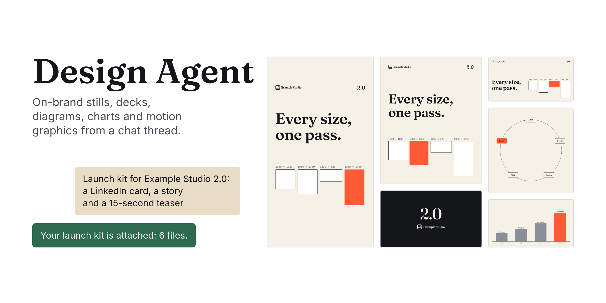
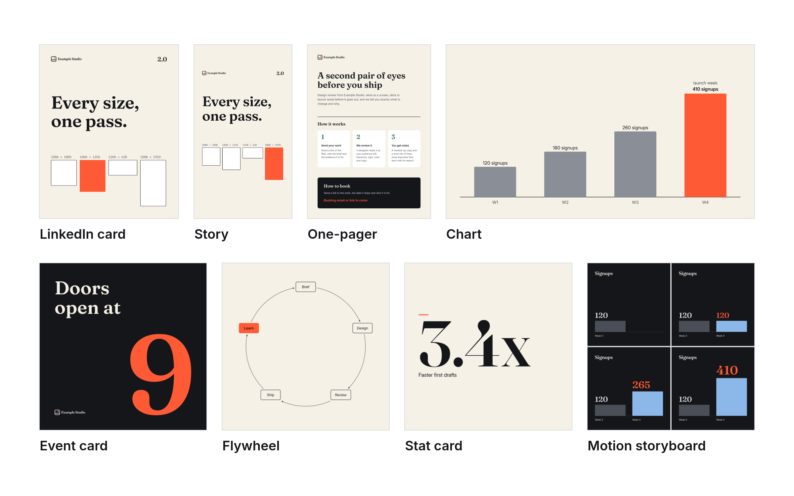
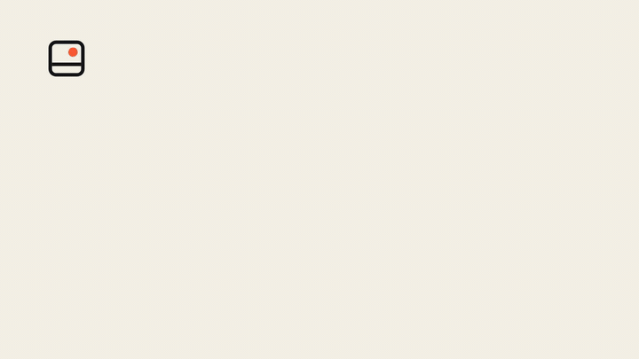
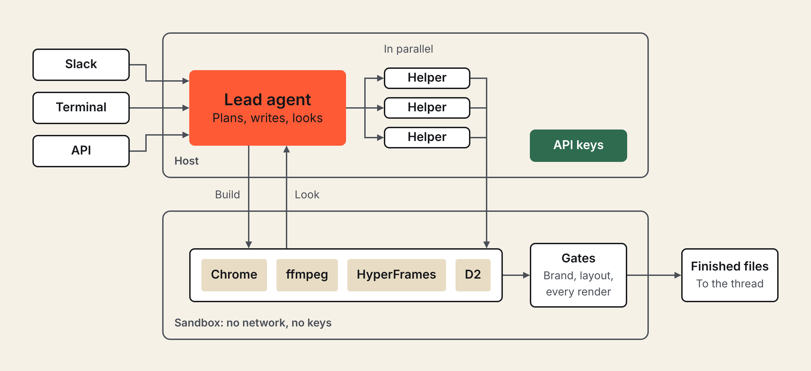

<div align="center">
  <h1>Design Agent</h1>
  <p>Built on <a href="https://github.com/langchain-ai/deepagents">Deep Agents</a>. Deploy with <a href="https://docs.langchain.com/langsmith/python/managed-deep-agents-overview">Managed Deep Agents</a> or self-host with Docker.<br>Renders with <a href="https://hyperframes.heygen.com">HyperFrames</a>. Designs with <a href="https://paper.design">Paper</a>.</p>
  <p>
    <a href="#quick-start">Quick start</a> ·
    <a href="#deployment">Deployment</a> ·
    <a href="OPERATIONS.md">Documentation</a> ·
    <a href="CONTRIBUTING.md">Contributing</a>
  </p>
</div>

<picture>
  <source media="(prefers-color-scheme: dark)" srcset="docs/assets/readme/hero-dark.png">
  
</picture>

<p align="center"><sub>Every image in this README was made by Design Agent, on its sample brand.</sub></p>

An open-source design agent for your team. Ask in Slack or the terminal for an ad set, a LinkedIn
card, a deck, a diagram, a chart, a thumbnail set, a storyboard or a short film; it makes the
concept, layout and copy calls, renders on its own computer, checks its work, and delivers the
files to the thread.

## What it makes

<a href="docs/assets/readme/gallery.png">
  
</a>

- **Stills and sets:** HTML layouts rendered in a real browser, every size recomposed rather than
  scaled; PDFs and decks; image edits; GIFs.
- **Diagrams and charts:** JSON specs through ECharts and D2, on brand.
- **Motion:** storyboards first, then HyperFrames compositions rendered to video, with voice,
  music and sound when keys are configured. Long films run as a pipeline of background helpers
  that ask you at the right moments.
- **On brand:** a brand pack (tokens, logos, fonts, voice, graphic language) is the agent's only
  source of brand facts; gates check every output against it.
- **Paper:** layouts and storyboards go on the Paper canvas as editable layers when Paper is
  connected.

<p align="center">
  <br>
  <sub>The 4-second teaser <code>design-agent demo</code> renders with no keys.</sub>
</p>

## How it works

<picture>
  <source media="(prefers-color-scheme: dark)" srcset="docs/assets/readme/how-it-works-dark.png">
  
</picture>

The model makes the creative calls. Code renders, measures, runs the gates, delivers files and
keeps credentials on the host: the sandbox never sees a key. More in
[Architecture](docs/architecture/README.md).

## Quick start

Requires **Python 3.11+**, [uv](https://docs.astral.sh/uv/) and **Docker**.

```bash
git clone https://github.com/langchain-ai/design-agent.git
cd design-agent
uv sync
uv run design-agent sandbox build
uv run design-agent demo
```

The demo needs no keys: a scripted run renders a launch card in three sizes and a 4-second teaser
for the sample brand, through the real agent, sandbox and gates, into `workspace/out/demo/`.

Then add a model (put `ANTHROPIC_API_KEY=…` in `.env` yourself, so the key stays out of your shell
history) and ask for something:

```bash
uv run design-agent config set DESIGN_AGENT_MODEL=anthropic:claude-opus-5-5
uv run design-agent test model
uv run design-agent ask "A LinkedIn card announcing our design review service, 1200x627."
```

Or let your coding agent set it up:

> Read AGENTS.md and .agents/skills/design-agent-onboarding/SKILL.md. Help me connect a model, add
> my brand, connect Paper, and choose a deployment path.

## Brand, media and Paper

| Add | How | Guide |
| --- | --- | --- |
| Your brand | `workspace/brand/` from your guide, site, files or a Paper file; the sample brand until then | [brand-onboarding skill](.agents/skills/brand-onboarding/SKILL.md) |
| Image generation | `OPENAI_API_KEY` | [Models](docs/models.md) |
| Voice, music, sound effects | `ELEVENLABS_API_KEY` | [sound skill](skills/sound/SKILL.md) |
| Paper canvas | `PAPER_MODE=local` with Paper Desktop, or `bridged` for a deployed agent | [Paper](docs/partners/paper.md) |
| Other MCP servers | `config/mcp.toml` | [Customization](docs/customization.md) |

Licensed fonts go in `private-fonts/` (Git-ignored); open fonts ship in `fonts/`.

## Deployment

Both paths run the same agent core.

| | Managed Deep Agents · recommended | Self-hosted |
| --- | --- | --- |
| Start | `uv run design-agent sandbox publish`, then `uv run design-agent deploy` | `docker compose -f deploy/self-host/compose.yaml up -d --build` |
| Hosting | managed by LangSmith | you operate the API, Postgres and Docker host |
| Sandboxes | managed, cloned per thread from your published snapshot | containers on your Docker host, or LangSmith sandboxes |
| Slack | managed app with workspace authorization | your app, Socket Mode or signed HTTP |
| Guide | [Deploy with MDA](docs/deploy-mda.md) | [Self-hosting](docs/self-hosting.md) |

**Managed Deep Agents** needs a LangSmith organization with MDA access and an API key with
deployment permission. `deploy` stages only what the agent needs, shows which secrets ship, and
asks before deploying. [Hosting is paid](https://www.langchain.com/pricing).

**Self-hosting** needs Docker. Compose starts Postgres, the API and the sandbox image; Slack is an
optional profile. You operate the infrastructure.

Model, image and audio charges apply to either path; each job's spend is estimated as it runs.

## Build on it

| Change or explore | Start here |
| --- | --- |
| Instructions, skills and taste | [instructions.md](instructions.md) · [skills/](skills/) · [Customization](docs/customization.md) |
| Models and cost | [Models](docs/models.md) · [Context and failures](docs/architecture/context-and-failures.md) |
| Background work, wake-ups, pipelines | [Orchestration](docs/architecture/orchestration.md) |
| The sandbox computer and gates | [sandbox/](sandbox/) · [workspace/tools/](workspace/tools/README.md) |
| Evals and the gallery | [Evals](docs/evals.md) |
| Operations and troubleshooting | [Operations](OPERATIONS.md) |
| Development and tests | [Contributing](CONTRIBUTING.md) · [Agent instructions](AGENTS.md) · [Coding-agent skills](.agents/skills/) |

---

[Apache 2.0](LICENSE) · [Notices](NOTICE.md) · [Changelog](CHANGELOG.md) · [Security](SECURITY.md) · [Code of conduct](CODE_OF_CONDUCT.md)
