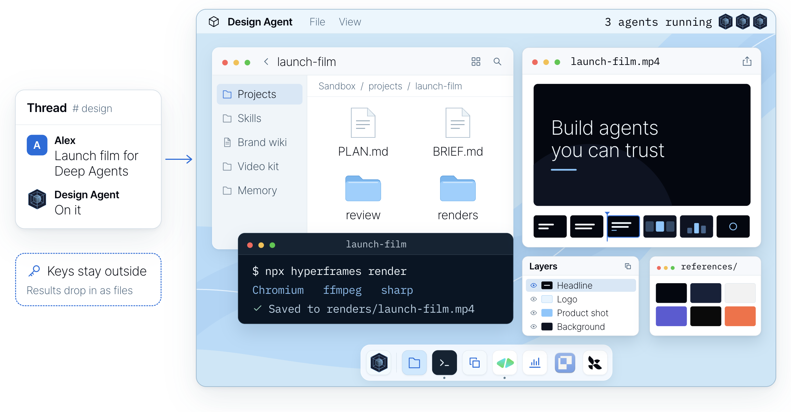

<div align="center">
  <p>
    <picture>
      <source media="(prefers-color-scheme: dark)" srcset="https://github.com/langchain-ai/design-agent/raw/main/docs/assets/readme/logos/langchain-company-dark.svg">
      <a href="https://www.langchain.com/?utm_source=github&utm_medium=readme&utm_campaign=design-agent"></a>
    </picture>
  </p>
  <picture>
    <source media="(prefers-color-scheme: dark)" srcset="https://github.com/langchain-ai/design-agent/raw/main/docs/assets/readme/header-dark.png">
    
  </picture>
  <p>
    <picture><source media="(prefers-color-scheme: dark)" srcset="https://shieldcn.dev/badge/license-Apache%202.0-7FC8FF.svg?variant=outline&logo=lu:Scale&mode=dark"><a href="LICENSE"></a></picture>
    <picture><source media="(prefers-color-scheme: dark)" srcset="https://shieldcn.dev/badge/python-3.11%2B-7FC8FF.svg?variant=outline&logo=python&mode=dark"><a href="https://www.python.org"></a></picture>
    <picture><source media="(prefers-color-scheme: dark)" srcset="https://shieldcn.dev/badge/built%20on-Deep%20Agents-7FC8FF.svg?variant=outline&logo=lu:Layers&mode=dark"><a href="https://github.com/langchain-ai/deepagents"></a></picture>
    <picture><source media="(prefers-color-scheme: dark)" srcset="https://shieldcn.dev/badge/deploy-Managed%20Deep%20Agents-7FC8FF.svg?variant=outline&logo=lu:Rocket&mode=dark"><a href="https://docs.langchain.com/langsmith/python/managed-deep-agents-overview?utm_source=github&utm_medium=readme&utm_campaign=design-agent"></a></picture>
  </p>
  <p>
    <b><a href="#quickstart">Distribute Content Studio to your team →</a></b> ·
    <a href="#try-it-locally">Try it locally, no keys needed</a> ·
    <a href="https://www.langchain.com/blog/how-we-built-our-design-agent?utm_source=github&utm_medium=readme&utm_campaign=design-agent">How we built it</a> ·
    <a href="docs/README.md">Docs</a>
  </p>
</div>

**Content Studio is the design agent LangChain runs, now open source.** Add your brand and deploy it
to your team's Slack with Managed Deep Agents. Anyone can ask it like they'd ask a designer, attach what they have, and
get finished, on-brand files back, from a resized ad to a launch film.

Since August it has shipped over 3,000 assets for us, posts with its work drew about 4.5M views on
X, and three in four requests come from outside marketing. [How we built it](https://www.langchain.com/blog/how-we-built-our-design-agent?utm_source=github&utm_medium=readme&utm_campaign=design-agent) goes deeper
into each part.

## See it work

We asked Content Studio for its own launch film. It went full Rocky.

https://github.com/user-attachments/assets/ee5b98e0-7ec6-4b24-ada6-1f27087947a3

<p align="center"><sub>From a 1-bit chick to champion in 47 seconds.</sub></p>

## How it works

Content Studio is a [Deep Agents](https://github.com/langchain-ai/deepagents) agent deployed on
[Managed Deep Agents](https://docs.langchain.com/langsmith/python/managed-deep-agents-overview?utm_source=github&utm_medium=readme&utm_campaign=design-agent).
Managed Deep Agents runs the infrastructure: Slack, sandboxes, memory, schedules and tracing. This
repo is the design agent on top. The model makes the creative calls, and code renders, checks and
delivers.

<p align="center">
  <picture>
    <source media="(prefers-color-scheme: dark)" srcset="https://github.com/langchain-ai/design-agent/raw/main/docs/assets/readme/architecture-dark.png">
    
  </picture>
</p>

<p align="center"><sub>How we run it at LangChain. Your copy starts with the integrations you turn on (<a href="docs/integrations.md">Integrations</a>).</sub></p>

- **Slack.** Mention it in a thread with a brief and any files. MDA's Slack app hands the message
  and attachments to the agent, and the finished files come back to the same thread. While it
  works, one message updates step by step, a footer shows what's running and the cost so far, and
  anything you add mid-job reaches the work in progress.
- **A computer per thread.** Each thread gets its own LangSmith sandbox: a Linux machine with
  Chrome, FFmpeg, [HyperFrames](https://hyperframes.heygen.com), D2 and your fonts, built from one
  pinned recipe ([`sandbox/setup.sh`](sandbox/)). Everything it makes is code in a project folder
  there (a slide is HTML, a film is an animation timeline), so a change is an edit and a re-render,
  not a restart. API keys never enter it.
- **Skills and a design wiki.** The always-on prompt is small. For each ask it first reads a router
  skill that picks the right workflow, from a resized ad to a launch film, out of 35
  [skills](skills/). The wiki holds the craft (type, colour, layout, charts) and your brand pack
  holds the facts. Skills load only when a job needs them, served by MDA from Context Hub.
- **Your tools.** Video is built in HyperFrames, which treats a film as a web page on a timeline.
  [Paper](https://paper.design) is a shared canvas where you edit a storyboard or layout directly.
  Image, voice and music models run as tools outside the sandbox, and MCP servers like Notion,
  Linear, GitHub and Figma connect through MDA, with each person signed in as themselves.
- **Async subagents.** On a big job the main agent plans, splits the work and starts subagents in
  the background on the same sandbox and files. MDA wakes it when one finishes, fails or stalls, so
  it never sits waiting and can keep talking to you. Films go storyboard, animatic, then
  production, and code makes every part pass review before assembly.
- **Memory.** Tell it a rule once ("never use orange on LinkedIn") and it saves it that turn. MDA
  gives it two layers of files: team memory everyone shares and personal memory for each person,
  and each layer's index loads into every run.
- **It gets better.** After a job, `learn_from_job` writes notes on what worked against the skill
  it used. Later jobs read and rate those notes, and the ones that don't hold up are dropped.

### Watch it explain itself

We asked it to explain its own harness as a nature documentary, starring a pixel parrot. It walks
through the computer, the tools and the context behind its work.

https://github.com/user-attachments/assets/0664d09d-2ab2-41fd-b2ba-f91c96121e20

<p align="center"><sub>Storyboarded, built and narrated by the agent, in one Slack thread.</sub></p>

<details>
<summary>The prompt that made this film</summary>

The agent made it from this ask and a few rounds of notes:

> Make a short explainer of how you create videos in code, end to end, for our blog post on the
> media harness we built on Deep Agents. Narrate it like a David Attenborough nature documentary,
> starring the pixel parrot from our promo, with your subagents as its flock. Keep it technical
> enough for an engineer, in real terms: skills, wiki, tools, apps. Storyboard it before you build,
> and end on "Built on Managed Deep Agents".

</details>

Read the [architecture](docs/architecture/README.md), or start changing it:
[instructions.md](instructions.md) · [skills/](skills/) · [Customization](docs/customization.md) ·
[Evals](docs/evals.md) · [Operations](OPERATIONS.md) · [Contributing](CONTRIBUTING.md).

## Why it doesn't look like AI

<p align="center">
  <picture>
    <source media="(prefers-color-scheme: dark)" srcset="https://github.com/langchain-ai/design-agent/raw/main/docs/assets/readme/same-prompt-dark.png">
    
  </picture>
</p>

<p align="center"><sub>The same prompt to a local coding agent with a brand skill, and to Content Studio.</sub></p>

- **It looks at its work.** It renders, then looks at the image before it posts anything.
- **Your brand is code.** Layouts only take your tokens: your colours, fonts and spacing.
- **It checks what a machine can count.** Colours, fonts, contrast, sizes and chart math are checked
  in code on every render. Taste stays with your designers.

<p align="center">
  
</p>

## Quickstart

| Building it yourself | Starting here |
| --- | --- |
| Months on a harness, a sandbox, skills and a Slack UX | Fork it, add your brand, deploy with one command |
| Polished work that looks like a hundred others | Work that follows your brand, checked on every render |
| Design requests wait in a queue | Anyone asks in Slack: a graphic in minutes, a long deck overnight |
| Every team fixes the same mistakes | Fix a skill once, and every asset after it follows |

This repository is a [Managed Deep Agents](https://docs.langchain.com/langsmith/python/managed-deep-agents-overview?utm_source=github&utm_medium=readme&utm_campaign=design-agent) project, so it deploys to your LangSmith
workspace as it is. You need MDA access and a model key:

```bash
curl -fsSL https://raw.githubusercontent.com/langchain-ai/design-agent/main/install.sh | bash
cd design-agent
uv run design-agent config set LANGSMITH_API_KEY=lsv2_… ANTHROPIC_API_KEY=sk-ant-…
uv run design-agent sandbox publish   # once per workspace: the agent's computer
uv run mda deploy
```

The installer gets [uv](https://docs.astral.sh/uv/) if you don't have it, clones the repository and
installs its dependencies; `git clone` and `uv sync` do the same.

The first deploy sets up the agent's Slack app. Authorize it in your workspace, then mention the
agent in a channel. It's how we run ours at LangChain. Try changes on a separate copy with
`uv run mda deploy --name design-agent-test`; [Deploy with MDA](docs/deploy-mda.md) covers keys,
what ships and checking it works.

**Or ask your coding agent.** Open the repo in Claude Code, Codex or Cursor and say what you want.
[AGENTS.md](AGENTS.md) routes each request to a step-by-step [skill](.agents/skills/):

| Say | It will |
| --- | --- |
| "Deploy it to our Slack." | publish the sandbox, check what ships, and deploy after your yes |
| "Build our brand pack from our website and brand guide." | draft the pack, validate it, and ask you to review it |
| "Teach it to make our weekly newsletter header." | add a skill for it and try it on a real request |
| "Did that change make it better?" | run the evals before and after, and show you the numbers |

## Try it locally

The demo runs the real agent, sandbox and checks with a scripted model and no API keys. It needs
**Docker**, and leaves a launch card in three sizes and a 4-second teaser in `workspace/out/demo/`:

```bash
uv run design-agent sandbox build
uv run design-agent demo
```

With a model key in `.env`, ask for something real. Files land in `workspace/out/<thread>/`, and the
last line tells you what the run cost:

```bash
uv run design-agent ask "A LinkedIn card announcing our design review service, 1200x627."
```

## Make it yours

| Want | Add | Guide |
| --- | --- | --- |
| Your brand | `workspace/brand/` (until then, a neutral sample brand) | [brand-onboarding skill](.agents/skills/brand-onboarding/SKILL.md) |
| Generated images | `OPENAI_API_KEY` | [Models](docs/models.md) |
| Voice, music, sound effects | `ELEVENLABS_API_KEY` | [sound skill](skills/sound/SKILL.md) |
| The Paper canvas | `PAPER_MODE=local` with Paper Desktop, or `bridged` when deployed | [Paper](docs/partners/paper.md) |
| Web search, your docs, other tools | MCP servers in `config/mcp.toml` | [Customization](docs/customization.md) |

Everything on this page uses LangChain's brand, because that's the one we run. Licensed fonts go in
`private-fonts/`, which Git ignores.

## Questions

**What does it cost?** The code is free (Apache 2.0). You pay your model provider: at LangChain the
median request costs about 50 cents in model spend, and long films and decks cost more. Managed Deep
Agents [hosting is paid](https://www.langchain.com/pricing?utm_source=github&utm_medium=readme&utm_campaign=design-agent); it runs the agent, the sandboxes,
the Slack app and the schedules that you'd otherwise build and operate yourself.

**Will it use my brand?** Yes. Add your brand pack and every file follows it. The
[brand-onboarding skill](.agents/skills/brand-onboarding/SKILL.md) builds the pack with you from
your brand guide, website, files or a Paper file.

**Where do I start?** With the graphic your team asks for every week. Let people brief the agent,
review the work and ask for changes in Slack, then teach it the next thing.

**Do I need Slack?** No. Call the deployment's API, open it in LangSmith Studio, or use the
terminal (`design-agent ask`). On Managed Deep Agents, long jobs that work in the background
(films, parallel looks) report back in Slack; over the API, keep to requests that finish in one
turn.

**Is it safe with my keys?** The sandbox never holds a credential and has no network by default.
Host tools do the fetching, generating and delivering, and drop results in as files.

**Which models?** Claude Opus 5.5 by default. OpenAI and Google models, any OpenAI-compatible
endpoint and the LangSmith Gateway work too. See [Models](docs/models.md).

**Can I run it on my own servers?** Yes. It's Apache 2.0, and [Self-hosting](docs/self-hosting.md)
runs the same agent with Docker, an HTTP API and your own Slack app.

**Why two names?** Content Studio is what we call the agent at LangChain, and the name its Slack app
gets unless you set `DESIGN_AGENT_SLACK_NAME`. The repository, package and command are `design-agent`.

**Does it replace a designer?** No. It takes the repetitive requests, so designers spend their time on
the work only they can do, and their judgment lives on in its skills and checks.

**Build your own.** Fork it, add your brand tokens, fonts and skills, and deploy it to your team's
Slack. [Quickstart](#quickstart). If it's useful, a star helps other teams find it.

## Built with

<p>
  <a href="https://github.com/langchain-ai/deepagents"> <b>Deep Agents</b></a>
  &nbsp;&nbsp;
  <a href="https://docs.langchain.com/langsmith/python/managed-deep-agents-overview?utm_source=github&utm_medium=readme&utm_campaign=design-agent"> <b>Managed Deep Agents</b></a>
  &nbsp;&nbsp;
  <a href="https://hyperframes.heygen.com"> <b>HyperFrames</b></a>
  &nbsp;&nbsp;
  <a href="https://paper.design"> <b>Paper</b></a>
</p>

Also: [LangSmith](https://smith.langchain.com/?utm_source=github&utm_medium=readme&utm_campaign=design-agent) ·
[Chrome Headless Shell](https://developer.chrome.com/blog/chrome-headless-shell) ·
[FFmpeg](https://ffmpeg.org) · [D2](https://d2lang.com) · [Apache ECharts](https://echarts.apache.org) ·
[sharp](https://sharp.pixelplumbing.com). Logos belong to their owners. HyperFrames and Paper are
partner projects we build on.

---

[Apache 2.0](LICENSE) · [Notices](NOTICE.md) · [Changelog](CHANGELOG.md) · [Security](SECURITY.md) · [Code of conduct](CODE_OF_CONDUCT.md)
