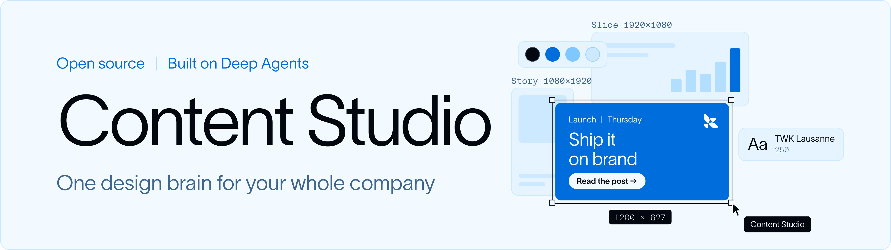
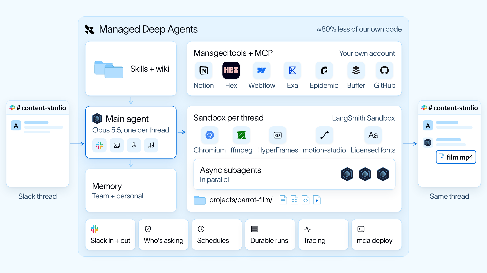
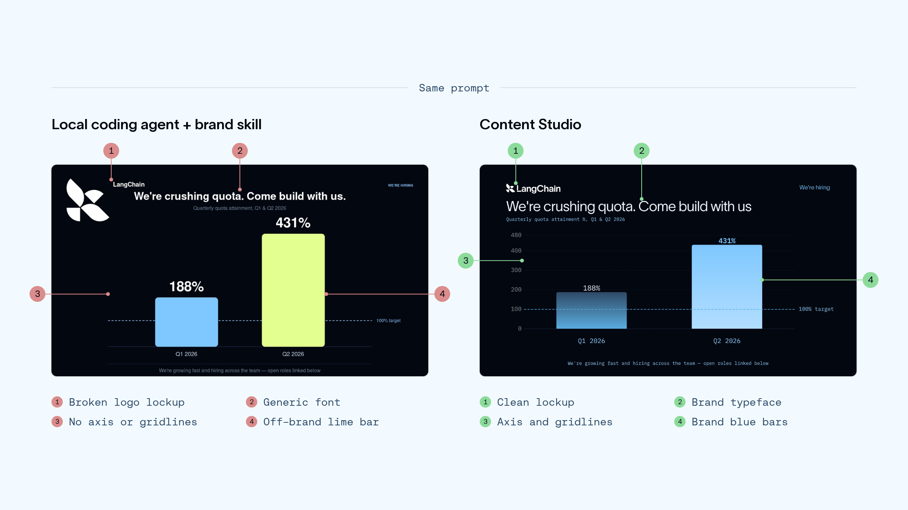
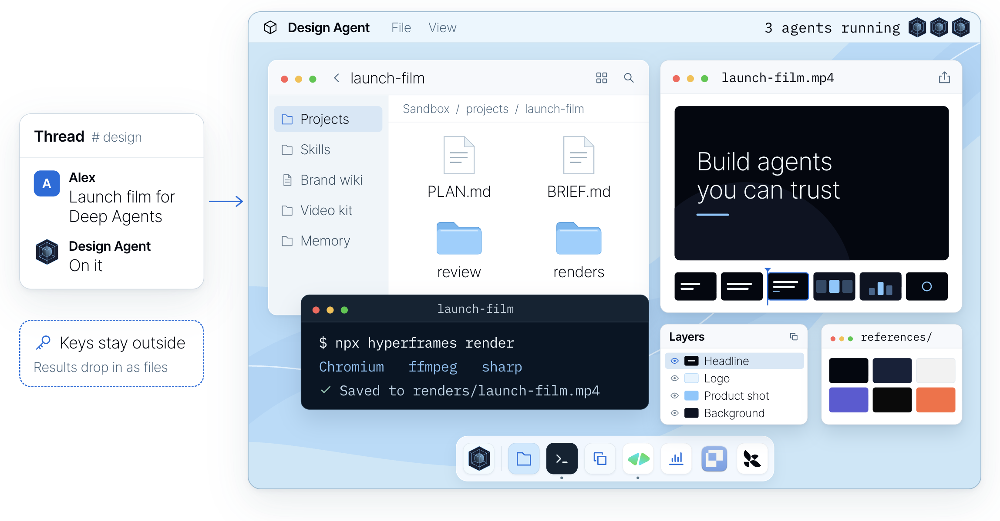

<div align="center">
  <p>
    <a href="https://www.langchain.com/?utm_source=github&utm_medium=readme&utm_campaign=design-agent#gh-light-mode-only"></a><a href="https://www.langchain.com/?utm_source=github&utm_medium=readme&utm_campaign=design-agent#gh-dark-mode-only"></a>
  </p>
  <picture>
    <source media="(prefers-color-scheme: dark)" srcset="https://github.com/langchain-ai/design-agent/raw/main/docs/assets/readme/header-dark.png">
    
  </picture>
  <h1>Content Studio：LangChain 开源的设计 Agent，Slack 里的设计助手</h1>
  <p>
    <a href="LICENSE#gh-light-mode-only"></a><a href="LICENSE#gh-dark-mode-only"></a>
    <a href="https://www.python.org#gh-light-mode-only"></a><a href="https://www.python.org#gh-dark-mode-only"></a>
    <a href="https://github.com/langchain-ai/deepagents#gh-light-mode-only"></a><a href="https://github.com/langchain-ai/deepagents#gh-dark-mode-only"></a>
    <a href="https://docs.langchain.com/langsmith/python/managed-deep-agents-overview?utm_source=github&utm_medium=readme&utm_campaign=design-agent#gh-light-mode-only"></a><a href="https://docs.langchain.com/langsmith/python/managed-deep-agents-overview?utm_source=github&utm_medium=readme&utm_campaign=design-agent#gh-dark-mode-only"></a>
  </p>
  <p>
    <b><a href="#quickstart">把 Content Studio 带给你的团队 →</a></b> ·
    <a href="#try-it-locally">本地试用，无需任何密钥</a> ·
    <a href="https://www.langchain.com/blog/design-agent?utm_source=github&utm_medium=readme&utm_campaign=design-agent">我们是如何构建它的</a> ·
    <a href="docs/README.md">文档</a>
  </p>
  <p>
    <a href="README.md">English</a> · <b>简体中文</b> · <a href="README.ja.md">日本語</a>
    <br><sub>本文译自英文 README，如有出入以英文版为准。</sub>
  </p>
</div>

**LangChain 开源了 Content Studio，这是我们自己在用的设计 Agent（设计智能体）。** 接入你的品牌，再用 Managed Deep Agents 把它部署到团队的 Slack，它就是你们 Slack 里的设计助手。任何人都能像找设计师一样跟它提需求、把手头的素材一并丢给它，直接拿回符合品牌规范的成品文件：小到广告图改尺寸，大到发布宣传片。

自 8 月以来，它已为我们交付了 3,000 多份设计物料，用了它作品的帖子在 X 上累计获得约 450 万次浏览，四分之三的需求来自市场部以外的团队。每个部分的细节，详见[我们是如何构建它的](https://www.langchain.com/blog/design-agent?utm_source=github&utm_medium=readme&utm_campaign=design-agent)一文。

## 看看效果

我们让 Content Studio 给自己做一部发布宣传片，结果它直接《洛奇》附体。

https://github.com/user-attachments/assets/ee5b98e0-7ec6-4b24-ada6-1f27087947a3

<p align="center"><sub>47 秒，从 1-bit 像素小鸡一路打成拳王。</sub></p>

## 设计 Agent 的工作原理

Content Studio 是一个基于 [Deep Agents](https://github.com/langchain-ai/deepagents) 构建的智能体，部署在 [Managed Deep Agents](https://docs.langchain.com/langsmith/python/managed-deep-agents-overview?utm_source=github&utm_medium=readme&utm_campaign=design-agent) 上。Managed Deep Agents 负责基础设施：Slack、沙箱、记忆、定时任务和追踪。本仓库就是跑在它上面的那层设计智能体。创意由模型拍板，渲染、检查和交付交给代码。

<p align="center">
  <picture>
    <source media="(prefers-color-scheme: dark)" srcset="https://github.com/langchain-ai/design-agent/raw/main/docs/assets/readme/architecture-dark.png">
    
  </picture>
</p>

<p align="center"><sub>这是我们在 LangChain 内部的部署方式。你自己部署的版本，起步时只包含你开启的集成（见<a href="docs/integrations.md">集成</a>）。</sub></p>

- **Slack。** 在 thread 里 @ 它，附上需求说明和相关文件。MDA 的 Slack 应用会把消息和附件交给智能体，成品会发回同一个 thread。干活期间，它只用一条消息实时更新进度，底部显示正在跑的任务和目前花了多少钱；中途补充的任何内容，也会同步给进行中的任务。
- **每个 thread 一台电脑。** 每个 thread 都有自己的 LangSmith 沙箱：一台 Linux 机器，装好了 Chrome、FFmpeg、[HyperFrames](https://hyperframes.heygen.com)、D2 和你的字体，按同一份锁定版本的脚本（[`sandbox/setup.sh`](sandbox/)）构建。它产出的一切都是项目文件夹中的代码（幻灯片是 HTML，影片是动画时间轴），所以改东西就是改代码、重新渲染，不用推倒重来。API 密钥从不进入沙箱。
- **技能（Skills）和设计知识库。** 常驻提示词很精简。每接到一个需求，它会先读一个路由技能，由它从 35 个[技能](skills/)里挑出合适的工作流，小到广告图改尺寸，大到发布宣传片。知识库管设计功底（字体排印、配色、版式、图表），品牌包管具体的品牌信息。技能按需加载，由 MDA 从 Context Hub 提供。
- **你的工具。** 视频用 HyperFrames 制作，它把影片当作时间轴上的网页来处理。[Paper](https://paper.design) 是一个共享画布，你可以直接在上面编辑分镜或版式。图像、语音和音乐模型作为沙箱外的工具运行；Notion、Linear、GitHub、Figma 等 MCP 服务器通过 MDA 接入，每个人用自己的账号登录。
- **异步子智能体。** 碰到大活儿，主智能体会先做计划、拆分任务，再在后台启动子智能体，共用同一个沙箱和同一批文件。任何一个子智能体完成、失败或卡住，MDA 都会唤醒主智能体，所以它从不干等，还能一直跟你聊。影片按分镜、动态分镜（animatic）、正式制作的顺序推进，代码会确保每个部分在合成前都通过审核。
- **记忆。** 规则只需说一次（“LinkedIn 上永远别用橙色”），它当场就会记下来。MDA 给它两层记忆文件：全员共享的团队记忆，和每个人自己的个人记忆；每次运行都会加载这两层的索引。
- **越用越好。** 每完成一个任务，`learn_from_job` 会把哪些做法管用记成笔记，挂在这次用到的技能下面。之后的任务会读这些笔记并打分，经不起检验的就会被淘汰。

### 看它现身说法

我们让它用自然纪录片的形式讲讲自己的 harness，主角是一只像素鹦鹉。片子会带你逛一遍它的电脑、它的工具，以及支撑它干活的上下文。

https://github.com/user-attachments/assets/65eac8e4-0fac-4a5a-9cca-02e26a0a8baa

<p align="center"><sub>分镜、制作和旁白，全由智能体在一个 Slack thread 里完成。</sub></p>

<details>
<summary>生成这部影片的提示词</summary>

智能体就是根据下面这段需求，加上几轮修改意见做出来的：

> Make a short explainer of how you create videos in code, end to end, for our blog post on the
> media harness we built on Deep Agents. Narrate it like a David Attenborough nature documentary,
> starring the pixel parrot from our promo, with your subagents as its flock. Keep it technical
> enough for an engineer, in real terms: skills, wiki, tools, apps. Storyboard it before you build,
> and end on "Built on Managed Deep Agents".

</details>

想深入可以看[架构说明](docs/architecture/README.md)，或者直接上手改：[instructions.md](instructions.md) · [skills/](skills/) · [定制](docs/customization.md) · [评测](docs/evals.md) · [运维](OPERATIONS.md) · [贡献指南](CONTRIBUTING.md)。

## 为什么它的作品没有 AI 味

<p align="center">
  <picture>
    <source media="(prefers-color-scheme: dark)" srcset="https://github.com/langchain-ai/design-agent/raw/main/docs/assets/readme/same-prompt-dark.png">
    
  </picture>
</p>

<p align="center"><sub>同一个提示词，分别交给带品牌技能的本地编程智能体和 Content Studio。</sub></p>

- **它会看自己的作品。** 先渲染，亲眼看过成图，才往外发。
- **你的品牌就是代码。** 版式只认你的 Design Token：你的颜色、字体和间距。
- **机器能量化的，都交给代码检查。** 颜色、字体、对比度、尺寸和图表计算，每次渲染都由代码查一遍。审美这件事，还是交给你的设计师。

<p align="center">
  
</p>

<a name="quickstart"></a>

## 快速开始

| 自己从零搭建 | 从这里开始 |
| --- | --- |
| 花几个月搭 harness、沙箱、技能和 Slack 交互 | Fork 仓库，加入你的品牌，一条命令部署 |
| 成品精致，却千篇一律 | 作品遵循你的品牌，每次渲染都经过检查 |
| 设计需求排长队 | 任何人都能在 Slack 里提需求：几分钟出图，长篇幻灯片一夜完成 |
| 每个团队都在填同样的坑 | 技能改一次，之后的每份物料都照着来 |

本仓库是一个 [Managed Deep Agents](https://docs.langchain.com/langsmith/python/managed-deep-agents-overview?utm_source=github&utm_medium=readme&utm_campaign=design-agent) 项目，不用改就能直接部署到你的 LangSmith 工作区。你需要一个 LangSmith 账号（Managed Deep Agents 目前在 LangSmith Cloud 上公测）和一个模型密钥：

```bash
curl -fsSL https://raw.githubusercontent.com/langchain-ai/design-agent/main/install.sh | bash
cd design-agent
uv run design-agent config set LANGSMITH_API_KEY=lsv2_… ANTHROPIC_API_KEY=sk-ant-…
uv run design-agent sandbox publish   # once per workspace, 10-15 min: the agent's computer
uv run mda deploy                     # the agent itself, and its Slack app
```

如果还没装 [uv](https://docs.astral.sh/uv/)，安装脚本会先帮你装上，然后克隆仓库、安装依赖；手动执行 `git clone` 和 `uv sync` 效果一样。

最后两条命令分工不同。`sandbox publish` 会构建每个 thread 干活用的 Linux 机器，作为快照保存在你的 LangSmith 工作区；这时还没有能跟你对话的智能体。`mda deploy` 才会部署智能体，它会为每个 thread 克隆一份那台机器。只有在 `sandbox/setup.sh` 变化时才需要重新发布。

**用的是 LangSmith Gateway？** 那就不用配模型服务商的密钥，直接运行 `uv run design-agent config set DESIGN_AGENT_MODEL=langsmith:anthropic/claude-opus-5-5`。之后智能体会使用 `LANGSMITH_GATEWAY_API_KEY`，没有则使用 `LANGSMITH_API_KEY`；在没有 `OPENAI_API_KEY` 时，图像生成也会经过网关。对于其他 OpenAI 兼容的端点，设置 `DESIGN_AGENT_MODEL_BASE_URL` 和 `DESIGN_AGENT_MODEL_API_KEY_ENV`（[模型](docs/models.md)）。

首次部署会顺带配好智能体的 Slack 应用。在你的 Slack 工作区里授权，然后到频道里 @ 它就行。我们在 LangChain 也是这么用的。可以用 `uv run mda deploy --name design-agent-test` 在单独的副本上试验修改。在开启了 agent 模式的工作区中，`uv run mda deploy --agent-environment production`（或 `staging`、`development`）会部署到该智能体的对应环境，每个环境都有各自的追踪记录：在 LangSmith 中打开智能体并选择环境即可。`uv run mda dev` 的追踪会记录到它的 Local 环境。[用 MDA 部署](docs/deploy-mda.md)介绍了密钥、部署内容以及如何验证部署。

**或者，直接交给你的编程智能体。** 在 Claude Code、Codex 或 Cursor 里打开仓库，说你想干什么就行。[AGENTS.md](AGENTS.md) 会把每个请求路由到对应的分步[技能](.agents/skills/)：

| 你说 | 它会 |
| --- | --- |
| “把它部署到我们的 Slack。” | 发布沙箱，检查哪些内容会上线，等你点头再部署 |
| “根据我们的官网和品牌手册生成品牌包。” | 先起草品牌包，校验一遍，再请你过目 |
| “教它做我们每周 Newsletter 的头图。” | 为此新增一个技能，并拿一个真实需求试一遍 |
| “这次改动让它变好了吗？” | 改动前后各跑一遍评测，拿数据说话 |

<a name="try-it-locally"></a>

## 本地试用

这个演示跑的是真实的智能体、沙箱和检查，只是把模型换成了按脚本输出的模型，不需要任何 API 密钥。需要装好 **Docker**，跑完会在 `workspace/out/demo/` 里留下三种尺寸的发布卡片和一段 4 秒的预告片：

```bash
uv run design-agent sandbox build
uv run design-agent demo
```

在 `.env` 里配好模型密钥，就能提真实需求了。生成的文件在 `workspace/out/<thread>/`，输出的最后一行会告诉你这次花了多少钱：

```bash
uv run design-agent ask "A LinkedIn card announcing our design review service, 1200x627."
```

## 接入你的品牌，打造自己的版本

本仓库有两类技能：[`.agents/skills/`](.agents/skills/) 里的是给你的编程智能体用的，负责配置、接入品牌、部署和修改这个仓库；[`skills/`](skills/) 里的是 Content Studio 干活时读的。[定制](docs/customization.md) 对两者都有介绍。

| 想要 | 添加 | 指南 |
| --- | --- | --- |
| 你的品牌 | `workspace/brand/`（没加之前用的是中性的示例品牌），然后重新部署 | [brand-onboarding 技能](.agents/skills/brand-onboarding/SKILL.md) |
| 生成图像 | `OPENAI_API_KEY`、`GOOGLE_API_KEY` 或 LangSmith Gateway | [模型](docs/models.md) |
| 语音、音乐、音效 | `ELEVENLABS_API_KEY` | [sound 技能](skills/sound/SKILL.md) |
| Paper 画布 | 搭配 Paper Desktop 使用 `PAPER_MODE=local`，部署后使用 `bridged` | [Paper](docs/partners/paper.md) |
| 网页搜索、你的文档、其他工具 | `config/mcp.toml` 中的 MCP 服务器 | [定制](docs/customization.md) |

部署好之后，就像找设计师一样在 Slack 里向它提需求：

- “为我们的新功能做一张发布卡片，要 LinkedIn、X 和 Instagram 三种尺寸。”
- “为我们的发布做一部《洛奇》风格的宣传片，配上音乐和音效。”
- “用这个 CSV 做一张每周注册人数的图表。”（附上文件）
- “给这个视频做一张 YouTube 封面。”
- “给这段网络研讨会片段加字幕。”（附上片段）

本页所有示例用的都是 LangChain 的品牌，因为我们自己跑的就是这一套。需要授权的字体放在 `private-fonts/`，这个目录已被 Git 忽略。

## 常见问题

**要花多少钱？** 代码免费（Apache 2.0）。你需要向模型服务商付费：在 LangChain，单个请求的模型花费中位数约为 50 美分，长影片和长篇幻灯片会更贵。Managed Deep Agents 的[托管是收费的](https://www.langchain.com/pricing?utm_source=github&utm_medium=readme&utm_campaign=design-agent)；它替你运行智能体、沙箱、Slack 应用和定时任务，这些本来都得你自己搭、自己运维。

**能用上我的品牌吗？** 能。加上你的品牌包后，产出的每个文件都会遵循它。[brand-onboarding 技能](.agents/skills/brand-onboarding/SKILL.md)会和你一起，根据你的品牌手册、官网、文件或 Paper 文件构建品牌包。

**从哪里开始？** 从你的团队每周都会要的那张图开始。让大家在 Slack 里向智能体提需求、审阅作品并要求修改，然后再教它下一件事。

**一定要用 Slack 吗？** 不用。你可以调用已部署实例的 API、在 LangSmith Studio 里打开它，或者用终端（`design-agent ask`）。部署在 Managed Deep Agents 上时，后台跑的长任务（影片、并行出多套方案）会回到 Slack 里汇报；走 API 的话，最好只提一轮就能完成的需求。

**我的密钥安全吗？** 沙箱从不保存任何凭证，默认也不联网。抓取、生成和交付都由宿主机上的工具完成，结果以文件形式放入沙箱。

**支持哪些模型？** 默认是 Claude Opus 5.5。OpenAI 和 Google 的模型、任何 OpenAI 兼容端点以及 LangSmith Gateway 也都可以使用。参见[模型](docs/models.md)。

**能私有化部署在自己的服务器上吗？** 可以。它采用 Apache 2.0 协议，按[自托管](docs/self-hosting.md)文档，用 Docker、HTTP API 和你自己的 Slack 应用就能跑起同一个智能体。

**为什么有两个名字？** Content Studio 是我们在 LangChain 内部对它的叫法，也是它的 Slack 应用的默认名字（设置 `DESIGN_AGENT_SLACK_NAME` 可以改）。仓库、包名和命令则都叫 `design-agent`。

**它会取代设计师吗？** 不会。它接走重复性的需求，让设计师把时间花在只有他们能做的事情上，而设计师的判断力会沉淀在它的技能和检查里。

**动手做一个你自己的。** Fork 仓库，加上你的品牌 Design Token、字体和技能，然后部署到团队的 Slack。[快速开始](#quickstart)。觉得有用的话，点个 Star，能让更多团队发现它。

## 技术栈

<p>
  <a href="https://github.com/langchain-ai/deepagents"> <b>Deep Agents</b></a>
  &nbsp;&nbsp;
  <a href="https://docs.langchain.com/langsmith/python/managed-deep-agents-overview?utm_source=github&utm_medium=readme&utm_campaign=design-agent"> <b>Managed Deep Agents</b></a>
  &nbsp;&nbsp;
  <a href="https://hyperframes.heygen.com"> <b>HyperFrames</b></a>
  &nbsp;&nbsp;
  <a href="https://paper.design"> <b>Paper</b></a>
</p>

还用到了：[LangSmith](https://smith.langchain.com/?utm_source=github&utm_medium=readme&utm_campaign=design-agent) · [Chrome Headless Shell](https://developer.chrome.com/blog/chrome-headless-shell) · [FFmpeg](https://ffmpeg.org) · [D2](https://d2lang.com) · [Apache ECharts](https://echarts.apache.org) · [sharp](https://sharp.pixelplumbing.com)。各 Logo 版权归各自所有者。HyperFrames 和 Paper 是我们所依托的合作伙伴项目。

---

[Apache 2.0](LICENSE) · [声明](NOTICE.md) · [更新日志](CHANGELOG.md) · [安全](SECURITY.md) · [行为准则](CODE_OF_CONDUCT.md)
